<p align="center">
  
</p>

<p align="center">
  <b>A pocketable hi-fi 2.1 Bluetooth / Wi-Fi speaker built around any Raspberry Pi.</b><br>
  Cheap, easy-to-source parts · 3S 18650 battery from recycled cells · 3D-printed acoustic enclosure · fully open source
</p>

<p align="center">
  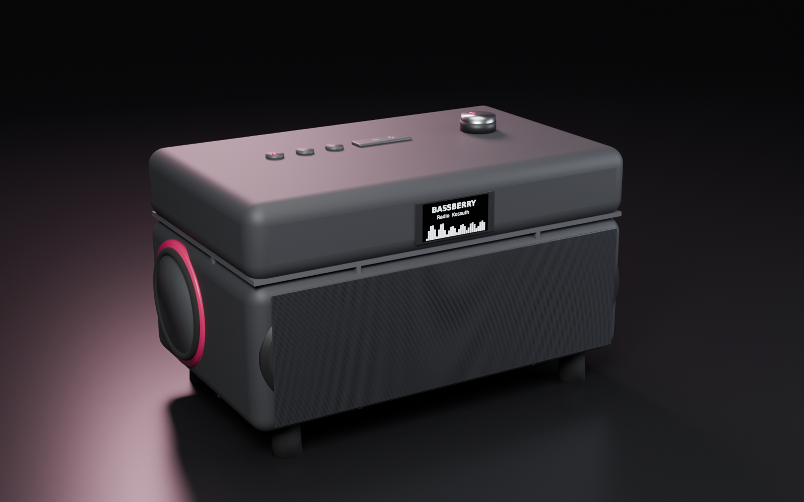
</p>

> **Status: rev 0.2 hardware in progress.** Acoustic design and simulation done. KiCad 10 schematic complete, with a HAT+ ID EEPROM so the Pi recognises the board. PCB placed by function and routed with srouter. A 4-layer digital twin verifies it against the datasheets. See [`hardware/`](hardware/).
> Everything here will change - issues and ideas are very welcome.

---

## Why

Raspberry Pi speaker HATs are either tiny mono buzzers or bare amplifier boards that leave the hard part to you: drivers, enclosure, power, battery.
Bassberry is the whole thing: a motherboard the Pi plugs into **upside down**, a DSP class-D 2.1 amplifier, USB-C PD charging, a clip-in 3S 18650 pack, and a simulated acoustic enclosure you can print at home.

It is the successor of [rfsparkling/RPi_Speaker](https://github.com/rfsparkling/RPi_Speaker) (an LM386 + GPIO-PWM board from 2016), redone properly.

## Highlights

| | |
|---|---|
| **Audio** | 2.1 channel, I2S digital all the way, 2× TI TAS5805M class-D with on-chip DSP (EQ, crossover, DRC) |
| **Drivers** | 2× 2" full-range satellites (sealed) + 1× 3.5" long-throw sub, down-firing, with 2 opposed passive radiators |
| **Response** | f₋₃ ≈ **64 Hz**, ±0.8 dB 100 Hz – 1 kHz (simulated, with DSP) |
| **Output** | ≈ **85 dB** broadband, **87 dB** @ 100 Hz, **94–97 dB** midrange @ 1 m (simulated) |
| **Host** | Every 40-pin Raspberry Pi: 1 A+/B+, 2, 3, 4, 5, Zero / Zero W / Zero 2 W - detected as a **HAT+** (ID EEPROM loads the overlay) |
| **Cooling** | Pi mounted upside down; SoC sits on an aluminium pedestal + gap pad into a 4-layer GND via field. No fan. |
| **Power** | USB-C PD in (5–20 V), 3S Li-ion buck-boost charging, 5.1 V / 5 A for the Pi, optional 18 V rail for the sub amp |
| **Battery** | 3× 18650 in snap-in holders with spring metal contacts - new or harvested cells, with balancing and reverse-cell indication |
| **UI** | 1.3" I2C OLED, power / BT / play / vol− / vol+ buttons, rotary encoder for menus (internet radio, EQ, sources) |
| **Size** | 230 × 120 × 140 mm |

## Renders

| Exterior | Rear (passive radiator, ports) |
|---|---|
|  | 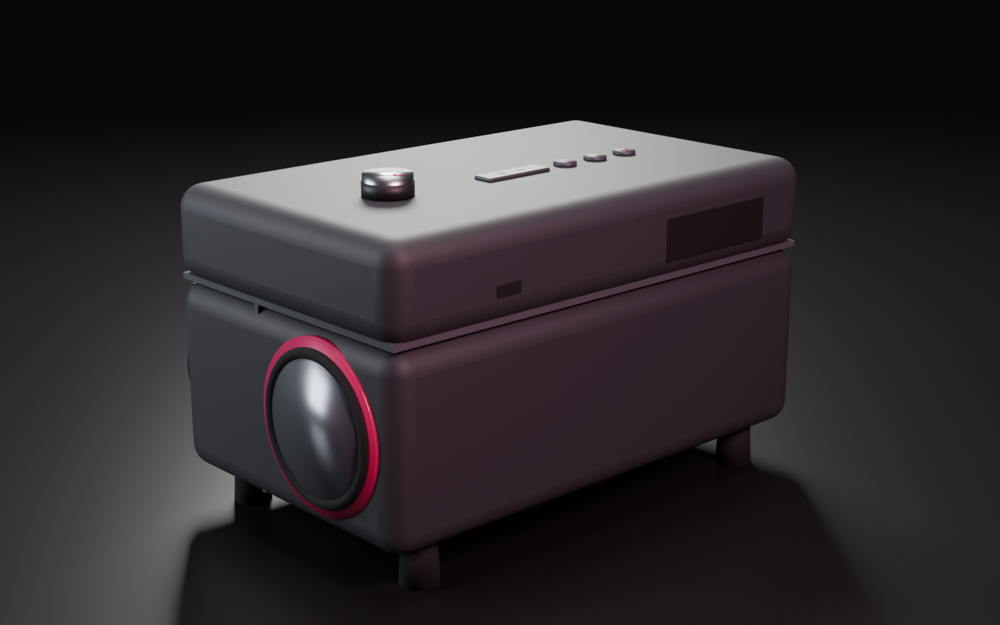 |
| **Interior: acoustic chambers** | **Exploded** |
| 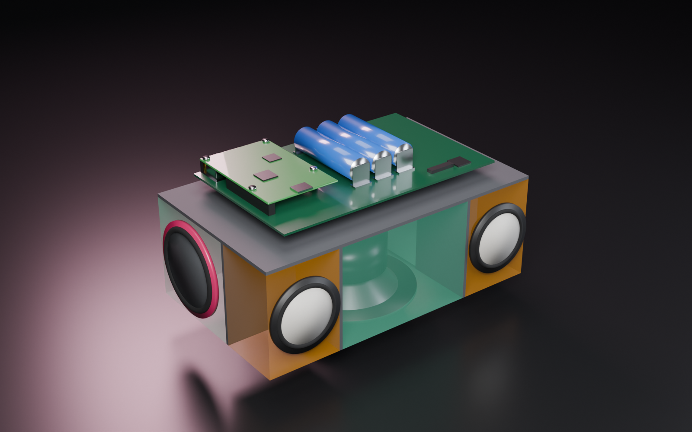 | 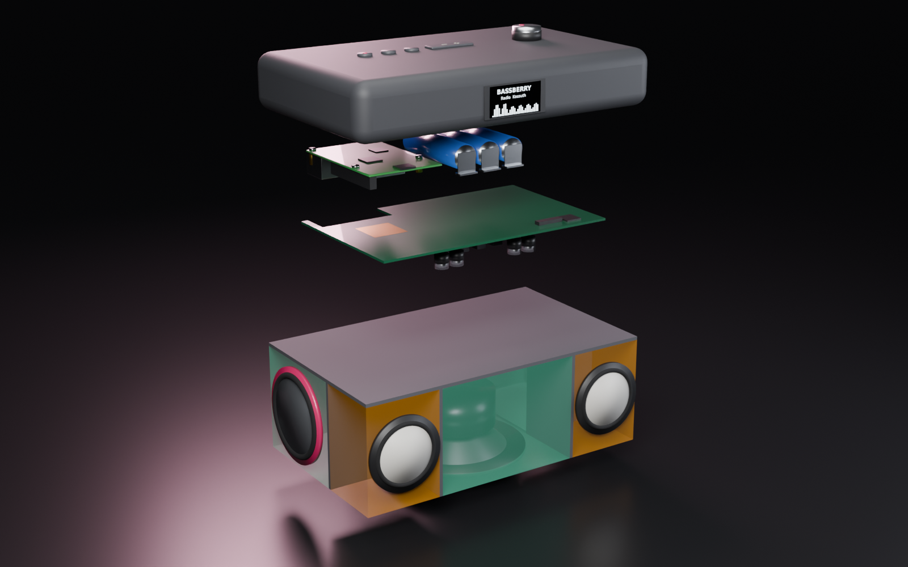 |
| **Top controls** | **Motherboard: upside-down Pi + 3S pack** |
| 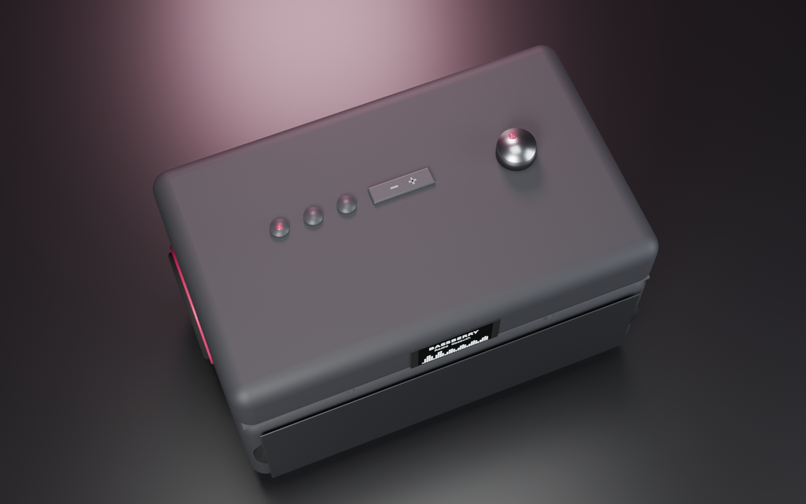 | 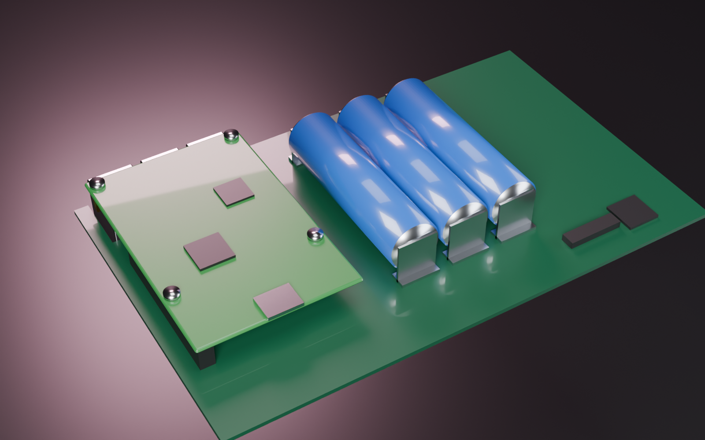 |

Renders are generated from code with Blender Cycles: [`render/render.py`](render/render.py).

### PCB rev 0.2 (KiCad 10, routed with srouter)

| Top (Pi socket face-down, 3× 18650, lid controls) | Bottom (amplifiers, charger, buck, supervisor) |
|---|---|
| 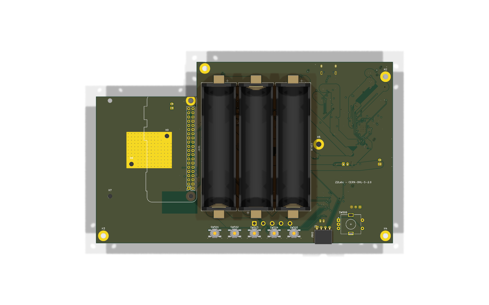 | 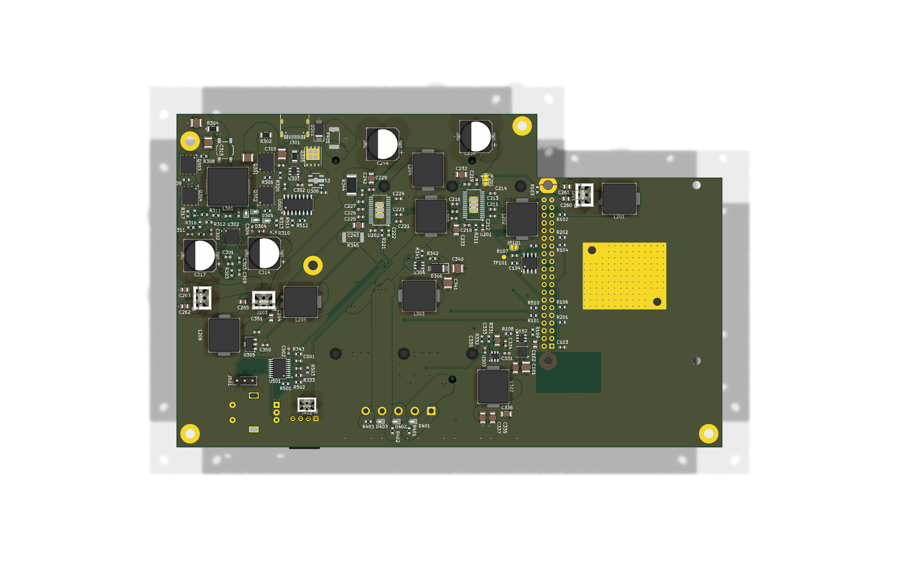 |

<p align="center">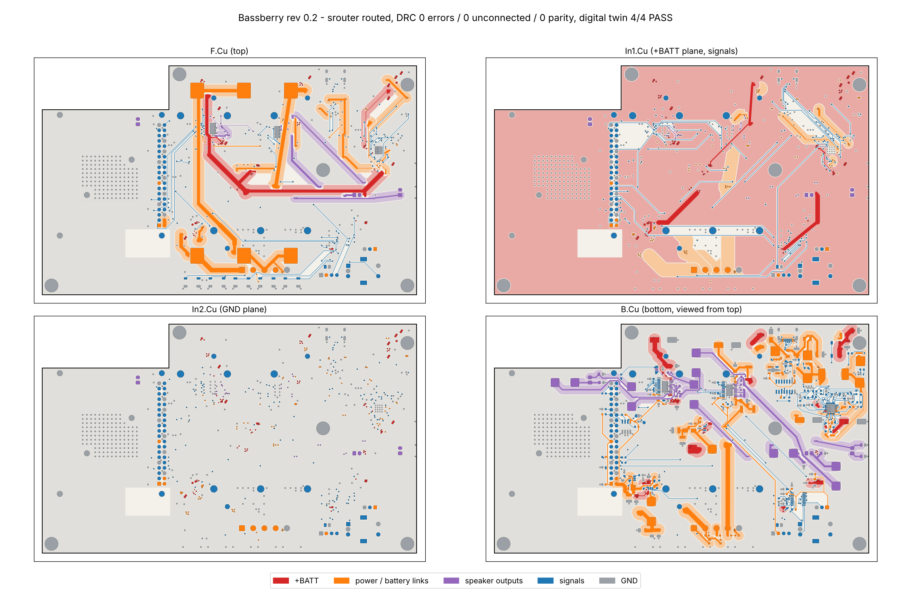</p>

180 × 110 mm, 4 layers. DRC 0 errors / 0 unconnected / 0 schematic-parity issues; digital twin layers 1-4 all PASS
(netlist vs datasheets, Pi plugged in face-down, copper ampacity incl. pours and vias, mechanics). Details in
[`hardware/README.md`](hardware/README.md).
Orange = sealed satellite chambers (0.20 l each), green = sub chamber (1.5 l) tuned by two opposed passive radiators.

## Acoustics

<p align="center">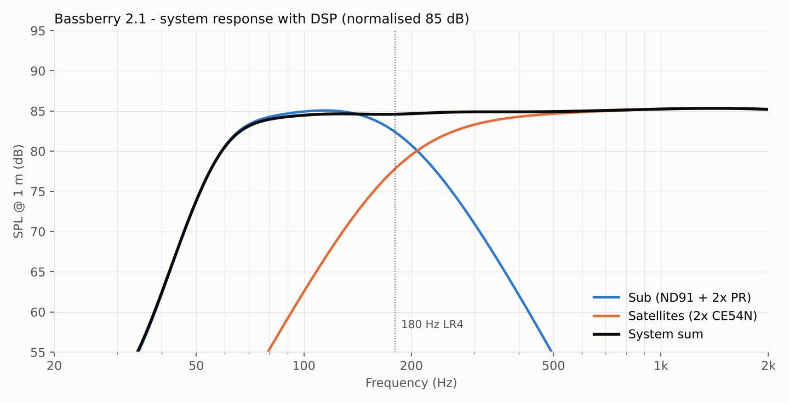</p>

* **Satellites:** 2× 2" full-range (reference: Dayton CE54N-4) in 0.20 l sealed chambers, crossed at 180 Hz LR4.
* **Sub:** 3.5" long-throw (reference: Dayton ND91-4, Xmax 4.6 mm), down-firing, 1.5 l, with 2× 2.5" passive radiators on the side walls facing each other, so their momentum cancels and the box does not walk at high bass. Tuned to 57 Hz.
* **DSP (in the TAS5805M):** LR4 crossover, Linkwitz transform on the satellites, baffle-step compensation, subsonic filter, bass EQ, dynamic range control.
* Full lumped-element model, max-SPL / excursion limits and a driver comparison: [`docs/acoustics.md`](docs/acoustics.md) and [`acoustics/`](acoustics/).
  Plug in your own driver's T/S parameters and re-run in seconds.

## Architecture

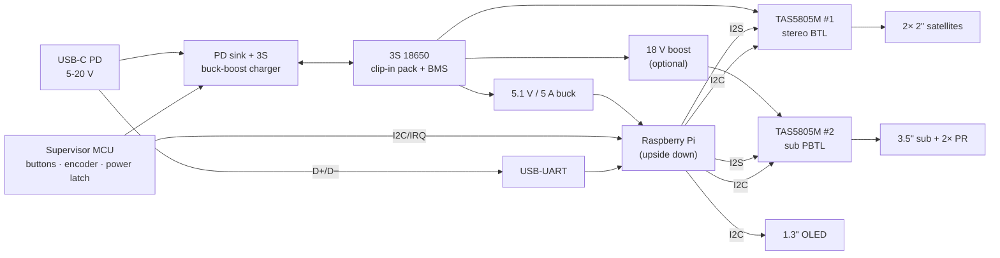

Details, pinout plan and power budget: [`docs/architecture.md`](docs/architecture.md).

## Built from cheap, common parts

The design rule is simple: **everything should be orderable from LCSC / AliExpress / your local electronics shop**, no exotic parts.
Amplifiers, charger, supervisor MCU, OLED, encoder and battery clips are all mass-market parts. Drivers come in two tiers:
reference drivers with published Thiele-Small data (what the simulation uses), or generic drivers that fit the same footprints, which you can measure and drop into the model.
See [`docs/bom.md`](docs/bom.md).

## Battery: recycled cells welcome

The pack is three 18650 cells in snap-in metal clips, so you can use new cells or ones harvested from old laptop packs.
Please read [`docs/battery.md`](docs/battery.md) first: matching, testing and the protections on the board.

## Roadmap

- [x] Concept, architecture, acoustic design and simulation
- [x] Schematic (KiCad 10, generated from [`hardware/tools`](hardware/tools))
- [ ] PCB layout, 4-layer, Pi thermal pedestal (rev 0.2: placed + routed, DRC / twin closure in progress)
- [ ] 3D-printable enclosure (STEP + STL), gaskets, damping
- [ ] Linux: dual TAS5805M 2.1 sound card, DSP profiles, supervisor daemon, OLED menu
- [ ] Prototype measurements vs simulation
- [ ] Build guide

## Repository layout

```
acoustics/   lumped-element simulation, plots, driver comparison
docs/        architecture, acoustics, BOM, battery guide, images
render/      Blender (bpy) script that generates the renders
tools/       helper scripts (banner, ...)
hardware/    KiCad 10 project + Python generators
enclosure/   CAD / STL (coming)
software/    Linux drivers, DSP profiles, UI (coming)
```

## License

* Hardware (`hardware/`, `enclosure/`): [CERN-OHL-S-2.0](LICENSES/CERN-OHL-S-2.0.txt)
* Software and scripts: [MIT](LICENSES/MIT.txt)
* Documentation and images: [CC-BY-SA-4.0](LICENSES/CC-BY-SA-4.0.txt)

Made by [Z2Labs](https://github.com/z2labs) in Budapest.
