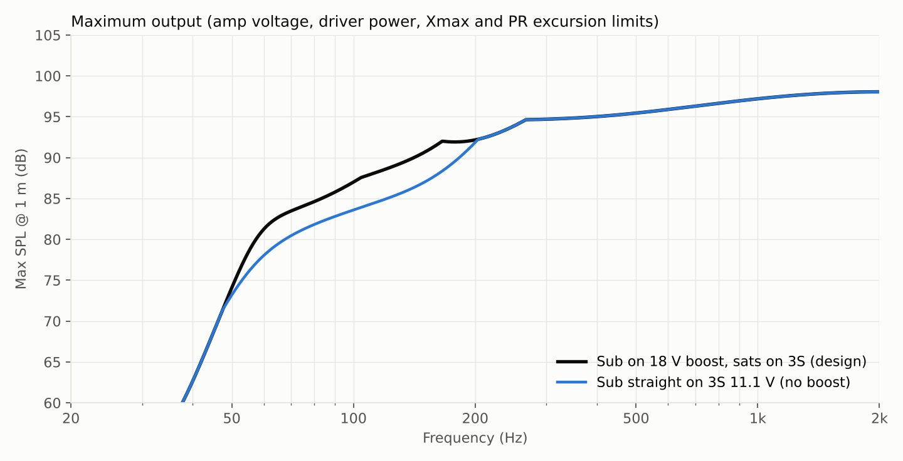
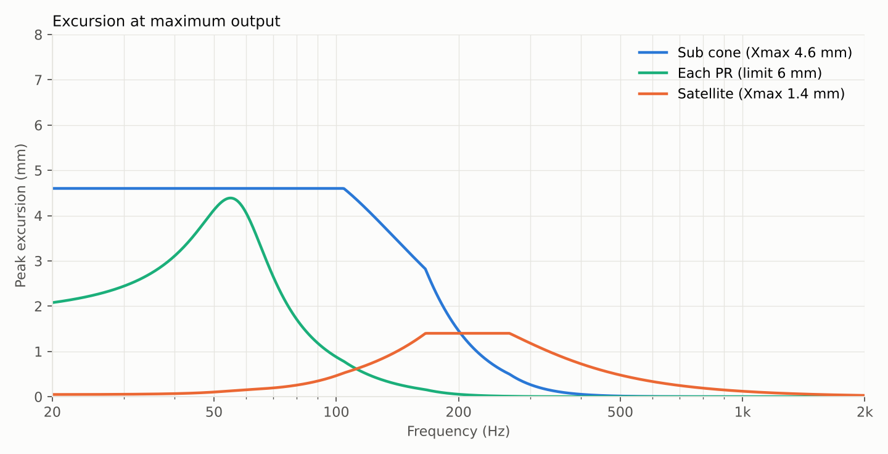
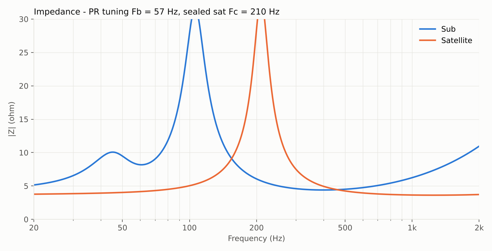
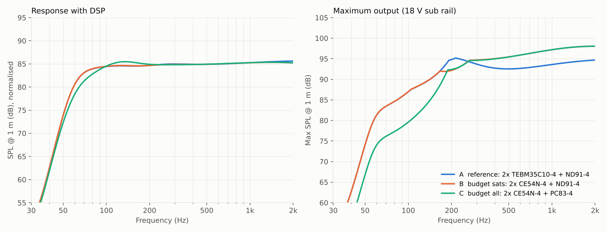

# Acoustic design

All numbers come from [`acoustics/sim.py`](../acoustics/sim.py), a lumped-element (electro-mechano-acoustic) model solved per frequency,
far field at 1 m in free space (4π) with a first-order baffle-step model. It is valid roughly 20 Hz – 1 kHz (piston range).
Above that the driver datasheets are the reference.

## Layout

| Section | Content | Net volume |
|---|---|---|
| Satellite chambers (front corners, sealed) | 1× 2" full-range each, 56 × 78 × 50 mm inside | 0.20 l each |
| Sub chamber (centre + rear wings) | 3.5" sub firing down through the base, 2× 2.5" passive radiators in the side walls, facing each other | 1.5 l |
| Electronics deck (above the divider) | motherboard, upside-down Pi, 3S pack | n/a (not acoustic) |

The divider between the electronics deck and the acoustic section must be airtight (gasket or glued seam).
The sub fires down into an 18 mm gap under the rubber feet. Below the 180 Hz crossover the sub is omnidirectional, so the direction does not matter, and the front baffle stays free for the satellites, the OLED and the grille.

## Reference drivers

| Role | Driver | Key data |
|---|---|---|
| Satellite | Dayton Audio CE54N-4 (2") | Fs 168 Hz, Qts 0.58, Vas 0.11 l, Sd 14.5 cm², Xmax 1.4 mm, 15 W |
| Satellite (alt.) | Tectonic TEBM35C10-4 (2" BMR) | Fs 148 Hz, Qts 0.83, Vas 0.18 l, very wide dispersion |
| Sub | Dayton Audio ND91-4 (3.5") | Fs 74 Hz, Qts 0.41, Vas 1.4 l, Sd 30.4 cm², **Xmax 4.6 mm**, 30 W |
| Passive radiator | 2× Dayton Audio DMA70-PR (2.5") | Fs 34.5 Hz, Mms 12 g, Sd 22.9 cm², Xmech 7 mm |

## Results (reference build, CE54N + ND91)

| Metric | Value |
|---|---|
| Satellite box | Fc 210 Hz, Qtc 0.71 (sealed) |
| Sub tuning | Fb 57 Hz (passive radiators) |
| System f₋₃ / f₋₆ | 64 Hz / 57 Hz |
| Ripple 100 Hz – 1 kHz | 0.8 dB |
| Max SPL @ 1 m, broadband (flat) | ≈ 85 dB |
| Max SPL @ 60 / 100 / 150 Hz | 81 / 87 / 91 dB |
| Max SPL @ 1 kHz | ≈ 97 dB |

On a table or near a wall the bass gains another 3–6 dB (half-space loading), which the model does not include.

**What limits the output**

* Below ≈ 100 Hz: sub cone excursion (Xmax). The passive radiators stay under 4 mm of their 7 mm.
* 100–180 Hz: sub amplifier voltage. This is why the sub amp gets an optional **18 V boost rail**: it adds ≈ +3.4 dB of bass and keeps the bass constant as the battery drains. Without it the sub runs straight off the 3S pack (9.6–12.6 V).
* Above the crossover: satellite power rating / amplifier voltage on the 3S rail.

## DSP chain (TAS5805M)

| Channel | Filters |
|---|---|
| Satellites | Linkwitz transform (Fc/Qtc → 180 Hz / 0.707) · 2nd-order Butterworth HP 180 Hz (together: acoustic LR4 HP) · baffle-step shelf −4.5 dB · level trim |
| Sub | LR4 LP 180 Hz · subsonic HP 42 Hz (Q 0.6) · +4 dB peak at 62 Hz (Q 1.2) · DRC that reduces the bass lift at high volume |

## Driver comparison

[`acoustics/compare.py`](../acoustics/compare.py) runs the same box with different drivers:

| Config | Drivers | f₋₃ | Flat max SPL | Max @ 100 Hz | Drivers cost (approx.) |
|---|---|---|---|---|---|
| A | 2× TEBM35C10-4 + ND91-4 | 64 Hz | 85.4 dB | 87.0 dB | ≈ 82 |
| **B (default)** | **2× CE54N-4 + ND91-4** | **64 Hz** | **85.3 dB** | **87.0 dB** | **≈ 77** |
| C | 2× CE54N-4 + PC83-4 | 74 Hz | 79.5 dB | 79.6 dB | ≈ 64 |

Costs are single-unit web prices in October 2026, in USD/EUR. The takeaway is that **the sub is where the money matters**: a 2 mm-Xmax 3" driver costs about 6 dB of bass.
Cheap generic drivers will work in the same footprints. Measure their T/S parameters and re-run the model, see below.

## Using your own drivers

1. Measure Re, Fs, Qts and Vas, plus Bl or Mms, with REW + a simple impedance jig (or DATS). Take Sd from the cone diameter and Xmax from the seller.
2. Put them into the `SAT` / `SUB` dicts in `acoustics/sim.py`.
3. `python3 sim.py` regenerates the plots and `summary.json`.
4. Copy the resulting filter values into the DSP profile (tooling to come in `software/`).

## Known model limits

* No cone break-up, no detailed diffraction, no room.
* Box losses are lumped (QL = 7). The real printed box will differ, especially if the walls are thin or flexible.
* Passive radiator linear excursion is assumed to be 6 mm (Xmech 7 mm).
* To be validated against measurements on the first prototype.
