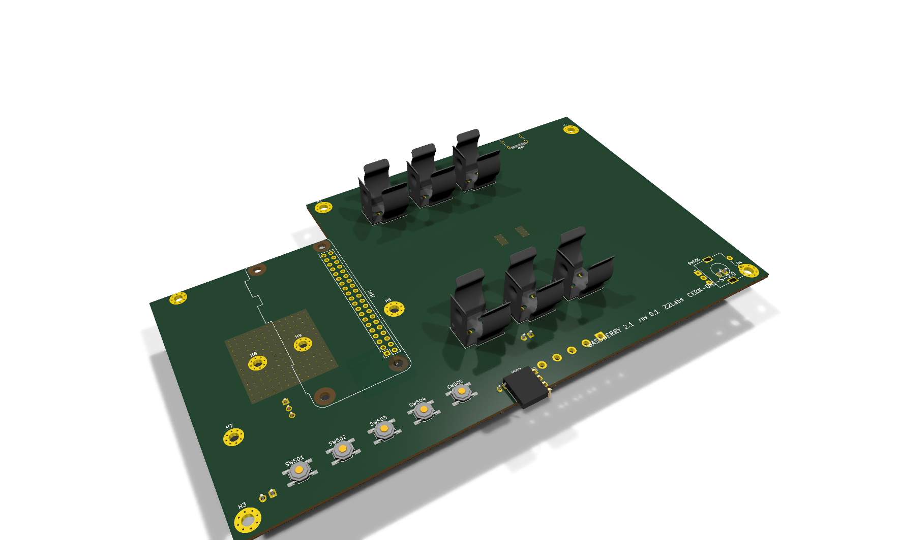

# Hardware - Bassberry motherboard (KiCad 10)

<p align="center"></p>

**Status: rev 0.2 (branch `feat/rev02-layout`) - HAT+ EEPROM, back-power diode, 18650 holders, functional placement, srouter routing, digital twin.**

Open `bassberry/bassberry.kicad_pro` in KiCad 10. A PDF of the schematic is in [`bassberry/bassberry_sch.pdf`](bassberry/bassberry_sch.pdf).

## Sheets

| Sheet | Content |
|---|---|
| `pi.kicad_sch` | 40-pin socket for a **face-down** Raspberry Pi (B+/2/3/4/5/Zero), I2S series termination, HAT+ ID EEPROM (CAT24C32 @ 0x50, WP jumper), back-power ideal diode |
| `audio.kicad_sch` | 2x TI TAS5805M: U201 stereo BTL (satellites, PVDD = VBAT), U202 PBTL (sub, PVDD_SUB), LC output filters, speaker connectors |
| `power.kicad_sch` | USB-C, Injoinic IP2366 PD3.1 3S buck-boost charger (30 W, 4.2 V/cell), TPS565208 5.1 V / 5 A Pi buck, optional MT3608 ~17 V sub boost, HT7533 LDOs |
| `battery.kicad_sch` | 3x 18650 in MYOUNG BH-18650-B1BA002 SMT holders (Keystone 1042 clone), off-the-shelf 3S BMS module (B-, B1, B2, B+, P-), reverse-cell LEDs, 10 A fuse, NTC |
| `ui.kicad_sch` | CH32V003 supervisor (power latch, buttons, encoder, VBAT sense, I2C slave to the Pi), OLED header, CH340C USB console |

Reference designators are numbered per sheet: 1xx Pi, 2xx audio, 3xx power, 4xx battery, 5xx UI.

## Board

* 180 x 110 mm, 4 layers, 1.6 mm. Layer roles as in srouter's rev-B3 flow: **F.Cu** signals + GND pour, **In1.Cu** signals
  (power stays on the outer layers), **In2.Cu** solid GND, **B.Cu** parts + signals + GND pour. Netclass 0.15 mm / 0.2 mm, via 0.6/0.3 mm.
* Top: face-down Pi (fitted to the Pi 4/5 hole pattern, ports over the open rear-left corner), three 18650 holders front-to-back
  with alternating polarity (series links 20 mm), USB-C at the rear, buttons / EC11 encoder / OLED socket in the front strip.
* Bottom: every other part, placed by function: each passive next to the pin it serves (`pcb_build.py`).
* Pi SoC thermal pad: covers the Pi 4 **and** the Pi 5 SoC lid (from the mechanical drawings), exposed copper both sides,
  0.3 mm GND via field, two M2.5 bolts for the aluminium pedestal. Copper keep-out under the Pi 4/5 Wi-Fi antenna corner.

## Regenerating (Windows, KiCad 10)

```powershell
powershell -File hardware\tools\regen_sch.ps1                       # schematic, ERC, netlist
& $py hardware\tools\pcb_build.py                                   # outline, placement, zones -> bassberry_placed.kicad_pcb
& $py hardware\tools\route.py                                       # srouter: escape gate, trunks + 3 passes, fatten
powershell -File hardware\tools\postroute.ps1                       # track_tidy, fill, gnd_stitch, via_rescue, stitch_audit,
                                                                     # silk_dfm, DRC --schematic-parity, digital twin 1-4
```

Routing follows `srouter/docs/USAGE.md`: GND is never routed (In2 plane + F/B pours, stitched afterwards).
* **Pass 0 (trunks)** - srouter gives a net one width that must fit its smallest pad, so a battery rail that also touches a
  0.3 mm amplifier pin would be 0.2 mm end to end. `route.py` therefore splits each high-current net on a scratch copy:
  the small pads go to a dummy net, and srouter joins only the big pads (holders, fuse, 2512 links, inductors, MOSFET tabs,
  connectors) at the widest width they allow (up to 1.6 mm). The later passes join the small pads to that trunk at their own
  width: the neck-down happens only in the last millimetres before a fine-pitch pin.
* **Pass 1a** - the rest of the high-current nets alone, on the outer copper only (In1 closed: 0.5 oz inner copper would need 3x the
  width), vias strongly avoided. srouter routes a net with one width that has to fit its smallest pad, so `fatten.py` then
  widens that copper wherever the clearance allows (necking only next to small pads, keeping a 0.5 mm escape lane around
  every foreign pad) and adds parallel vias at its layer changes.
* **Pass 1b** - everything that escapes from between power pins (the IP2366 QFN, the amp bootstrap pins) and the 3V3 rails.
* **Pass 2** - I2S, I2C, USB D+/D- (crossover under the receptacle pre-routed), HAT ID, every other Pi header net.
* **Pass 3** - the rest.
* **Post** (`postroute.ps1`, the USAGE.md order): track_tidy, `power_pour.py` (a priority-5 copper pour hugging every
  high-current track on F.Cu, In1.Cu and B.Cu, filled only into free space, plus ceil(I / 1.5 A) parallel vias at every
  layer change of a high-current net), zone fill, gnd_stitch, via_rescue, stitch_audit, silk_dfm, zone refill, DRC with
  schematic parity, digital twin 1-4. `full_flow.ps1` runs everything unattended.
* Gates: `escape_probe.py` (no pad walled in before routing), the pre-route twin layers 1/2/4; `full_flow.ps1` stops on any failure.
* Repairs: `tidy_guard.py` re-joins what srouter's track_tidy pulls apart (pads, track pieces, lost layer changes) and drops dangling stubs;
  GND pins with no room for a via get one between the pin rows (0.45/0.2 mm) or a short link to the nearest GND.

## Digital twin

`hardware/twin/` - four layers, spec written only from datasheets and the Raspberry Pi documents, each with injected-fault
self-tests. See [`twin/README.md`](twin/README.md).

## Result (rev 0.2, `hardware/bassberry/route/`)

| Check | Result |
|---|---|
| ERC | 2 expected errors only (TAS5805M PBTL output pairing, as in the TI datasheet) |
| Routing | every net routed by srouter (trunk pass, 3 passes, automatic rip-up and reroute for nets left over) |
| DRC (`--schematic-parity --severity-all`) | **0 errors, 0 unconnected, 0 parity**; 152 warnings: 122 `lib_footprint_mismatch` (silk_dfm moved/cut silkscreen inside the footprints), 29 silkscreen cosmetics, 1 copper sliver |
| Twin layer 1 (netlist vs source documents) | 170 PASS, 10 WARN (physical checks + accepted deviations), 0 FAIL; 16/16 injected faults caught |
| Twin layer 2 (Pi 4/5 plugged in face-down) | 7 + 31 PASS; 2/2 injected faults caught |
| Twin layer 3 (copper ampacity, set-points, LDO) | 36 PASS, 0 FAIL; 2/2 injected faults caught |
| Twin layer 4 (mechanics) | 37 PASS; 4/4 injected faults caught |

How the power copper was made to pass layer 3 (all automatic, `power_pour.py`): corridor pours per high-current net on
F.Cu / In1.Cu / B.Cu splitting the room between neighbouring nets, a **+BATT plane on In1.Cu** fed by taps from every
+BATT pad, In1 copies of the battery-link pours (joined by the holder through-hole contacts), and vias grown to 1.0/0.5 mm
or doubled until each layer change carries its current. The buck converter is turned so its SW pin points straight at the
inductor, the ZVD PFET so its source pins face the Pi 5 V pins.

## Known open items (rev 0.2)

- [ ] ERC: 2 expected errors - TAS5805M PBTL pre-filter output pairing (OUT_A+/OUT_A-, OUT_B+/OUT_B-), exactly as in TI's datasheet fig. "MONO (PBTL) Systems".
- [ ] Confirm the Pi antenna keep-out on a real Pi 4 / Pi 5 / Pi 3B+.
- [ ] CH340C supply current from the current WCH datasheet (the LDO dissipation check at a 20 V PD contract uses 15 mA).
- [ ] TDSON MOSFETs: pick the final cheap part (30-40 V, ~5 mOhm, JEDEC SO-8FL pin-out).
- [ ] Device tree overlay and DSP profiles (`software/overlay`, draft).
